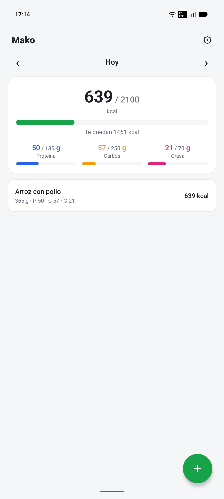
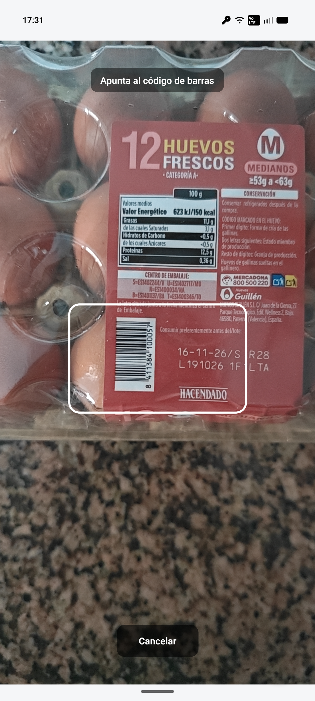
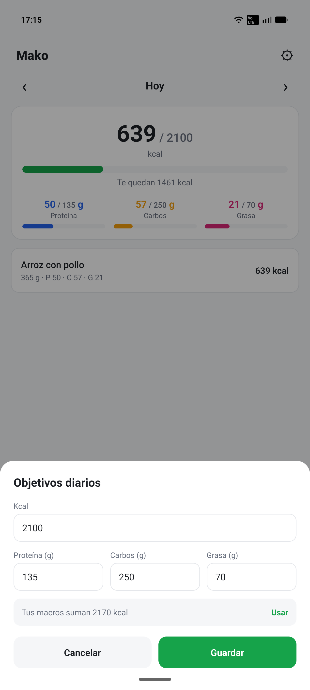
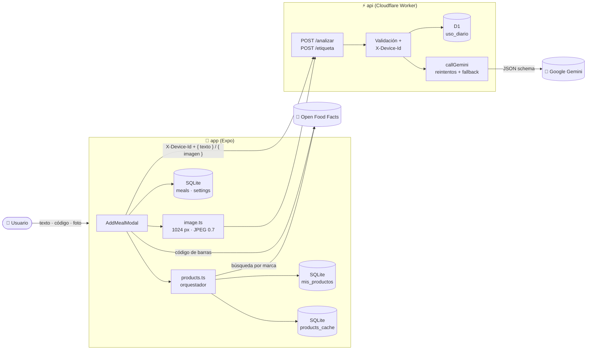
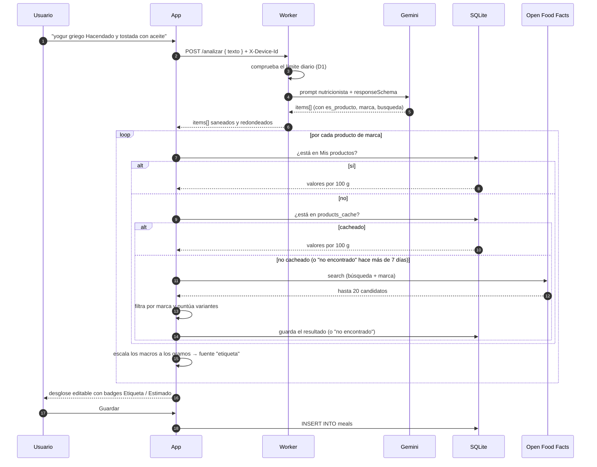
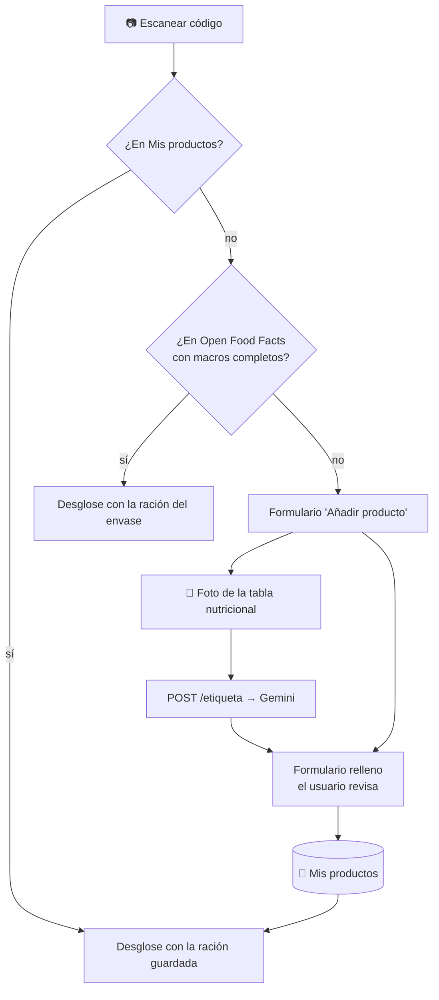

<div align="center">


# Mako

### Cuenta calorías y macros escribiendo lo que has comido, escaneando el código de barras o haciendo una foto a la etiqueta.

*"plato de garbanzos con pollo y una caña"* → **kcal · proteína · carbos · grasa**, al momento.

<br/>


<br/>


<br/>

[📸 Capturas](#-capturas) ·
[✨ Funcionalidades](#-funcionalidades) ·
[🏗️ Arquitectura](#️-arquitectura) ·
[🚀 Puesta en marcha](#-puesta-en-marcha) ·
[📡 API](#-api)

</div>

---

## 💡 ¿Qué es Mako?

**Mako** es una app móvil para llevar el registro diario de lo que comes **sin pesar nada y sin buscar en bases de datos interminables**. Hay tres formas de añadir una comida:

1. **Escribiéndola** en lenguaje natural, como se lo contarías a un amigo. Una IA nutricionista pensada para la **cocina española** la separa en ingredientes, estima las raciones y calcula los macros.
2. **Escaneando el código de barras** del envase, que trae los valores reales de [Open Food Facts](https://es.openfoodfacts.org).
3. **Haciendo una foto a la tabla nutricional** cuando el producto no está en ninguna base de datos. La IA la lee y el producto se guarda en *Mis productos* para la próxima vez.

¿Y si al escribir mencionas una marca? *"Una Coca-Cola Zero y un yogur griego Hacendado"* → Mako detecta que son **productos envasados** y busca los **valores reales de la etiqueta**: primero en tus productos guardados y luego en Open Food Facts. Lo casero se estima y lo envasado se saca de la etiqueta.

<!-- IMAGEN: GIF del flujo completo (escribir una comida → Analizar → desglose → Guardar)
<div align="center">
  
</div>
-->

El proyecto es un **monorepo** con dos piezas:

| Proyecto | Qué es | Stack |
|---|---|---|
| 📱 [`app/`](./app) | La app móvil (Android · iOS) | Expo 58 · React Native 0.88 · React 19 · `expo-sqlite` · `expo-camera` |
| ⚡ [`api/`](./api) | Backend serverless que habla con la IA | Cloudflare Workers · D1 · Gemini · Wrangler · Vitest |

---

## 📸 Capturas

<!-- IMAGEN: fila 1 (pantalla del día, análisis con IA, desglose)
<p align="center">
  
  
  
</p>
-->

<!-- IMAGEN: fila 2 (escáner, foto de etiqueta, objetivos)
<p align="center">
  
  
  
</p>
-->

---

## ✨ Funcionalidades

<table>
<tr>
<td width="50%" valign="top">

### 🧠 Análisis con IA
- Describe la comida en **lenguaje natural**, sin pesos.
- Desglose automático en **ingredientes principales**.
- Si no indicas cantidad, usa la ración normal de un adulto en España.
- Respeta las cantidades que digas: *"2 huevos"*, *"media pizza"*, *"200 g"*.
- Incluye el **aceite** de cocinar o aliñar cuando el plato lo lleva (el gran olvidado 👀).

</td>
<td width="50%" valign="top">

### 🏷️ Productos de marca → datos reales
- Detecta marcas y supermercados (Hacendado, Lidl, Danone, Coca-Cola…).
- *"Mercadona"* se traduce a **Hacendado** automáticamente.
- Busca primero en **Mis productos** y después en **Open Food Facts**, con un sistema de puntuación propio.
- Distingue variantes: **zero, light, sin azúcar, desnatado…**
- Cada ingrediente muestra su origen: `Etiqueta` ✅ o `Estimado` 🤖.

</td>
</tr>
<tr>
<td width="50%" valign="top">

### 📷 Código de barras y foto de etiqueta
- **Escanea** EAN-13, EAN-8 y UPC con la cámara.
- Consulta directa a Open Food Facts por código, con la ración del envase por defecto.
- ¿No aparece? **Haz una foto a la tabla nutricional** y la IA rellena kcal, proteína, carbos, grasa, nombre, marca y ración.
- Convierte kJ a kcal y descarta lecturas imposibles.
- El producto se guarda en **Mis productos** con su código, así que la próxima vez se encuentra sin conexión.

</td>
<td width="50%" valign="top">

### 🎯 Objetivos diarios
- Fija tu objetivo de **kcal, proteína, carbos y grasa**.
- Mako te dice **cuántas kcal suman tus macros** y te deja usar ese valor con un toque.
- La tarjeta de totales muestra **barras de progreso** (`72 / 140 g`) y cuántas kcal **te quedan**.
- Las barras se ponen en rojo cuando te pasas.

</td>
</tr>
<tr>
<td width="50%" valign="top">

### ✏️ Control total
- Ajusta los **gramos** de cada ingrediente y los macros se recalculan al momento.
- Elimina ingredientes que la IA haya añadido de más.
- Modo **manual** para meter los valores a mano.
- Mantén pulsada una comida para **borrarla**.

</td>
<td width="50%" valign="top">

### 📅 Diario offline-first
- Navega por días: **Hoy, Ayer, Mañana** y cualquier fecha.
- Totales del día: **kcal, proteína, carbos y grasa**.
- Todo se guarda **en el dispositivo** con SQLite (WAL).
- Caché local de productos: menos peticiones y respuestas más rápidas.

</td>
</tr>
</table>

---

## 🏗️ Arquitectura



### 🔄 El viaje de una comida escrita



### 📷 Código de barras y foto de etiqueta



### 🧩 Detalles que marcan la diferencia

<details>
<summary><b>⚡ Backend resiliente con fallback de modelos</b></summary>

<br/>

El Worker no depende de un único modelo. Los prueba en cascada:

```ts
const MODELS = ['gemini-3.5-flash-lite', 'gemini-3.1-flash-lite'];
```

Cada modelo se intenta **2 veces** con backoff (500 ms, 1000 ms) cuando hay errores `500/503/504`. Si todo falla, devuelve un error legible (`saturado`, `cuota`, `ia`) que la app traduce a mensajes en español.

La respuesta de Gemini se fuerza con `responseMimeType: application/json` + `responseSchema` y luego se **sanea**: los números negativos o no finitos pasan a 0, se redondea y `marca`/`busqueda` quedan vacíos si no es un producto.

</details>

<details>
<summary><b>🛡️ Límite de uso por dispositivo</b></summary>

<br/>

Para que nadie se coma la cuota de Gemini, cada instalación genera un **UUID** (`expo-crypto`) que se guarda en `settings` y se envía en la cabecera `X-Device-Id`. El Worker:

- Rechaza las peticiones sin ID o con un ID mal formado (`400 sin_dispositivo`) **antes** de llamar a la IA.
- Cuenta las peticiones de cada día en **Cloudflare D1** con un único `INSERT … ON CONFLICT … RETURNING`, en batch junto al contador global.
- Corta con `429 limite_diario` al pasar de **50 análisis por dispositivo y día**, y con `429 servicio_lleno` al pasar de **1000 en total**.
- Los límites se pueden cambiar con las variables `LIMITE_DISPOSITIVO` y `LIMITE_GLOBAL`.

Cuando se llega al límite, la app propone escanear el código de barras o meter la comida a mano, porque esas opciones no gastan IA.

</details>

<details>
<summary><b>📸 Lectura de etiquetas con visión</b></summary>

<br/>

- La app reduce la foto a **1024 px de ancho en JPEG 0.7** (suele quedar en 100-300 KB) antes de enviarla.
- El Worker corta por `Content-Length` antes de leer el body, valida el base64 y el tipo (`jpeg`, `png`, `webp`).
- Gemini devuelve los valores **por 100 g** y un campo `legible`. Si no está seguro, la app recibe `422 etiqueta_ilegible` en lugar de valores inventados.
- **Red de seguridad para kJ**: si las "kcal" superan con mucho a `4·P + 4·C + 9·G`, se interpretan como kJ y se convierten.
- Se descartan los valores imposibles (más de 950 kcal o más de 100 g de un macro por cada 100 g).

</details>

<details>
<summary><b>🎯 Matching inteligente con Open Food Facts</b></summary>

<br/>

Buscar *"coca cola"* en una base de datos colaborativa devuelve de todo. El orquestador (`products.ts` + `openfoodfacts.ts`):

1. **Normaliza** el texto (minúsculas, sin tildes ni símbolos).
2. **Filtra por marca** (coincidencia parcial o por la primera palabra).
3. **Descarta** los productos sin kcal, proteína, carbos o grasa (y convierte kJ a kcal si hace falta).
4. **Puntúa**: +1 por cada palabra de la búsqueda que aparece en el nombre y **−3** por cada variante (`zero`, `light`, `sin azucar`, `desnatad`…) que no coincide entre lo pedido y lo encontrado. Así una Coca-Cola normal nunca se confunde con una Zero.
5. Se queda con el **mejor candidato** y escala sus valores por 100 g a los gramos reales.

Los productos guardados en *Mis productos* se buscan antes con reglas parecidas: misma marca, sin variantes distintas y al menos el **60 %** de las palabras buscadas en el nombre.

</details>

<details>
<summary><b>💾 Base de datos local con migraciones versionadas</b></summary>

<br/>

SQLite con `PRAGMA user_version` para migrar sin perder datos:

| Versión | Cambio |
|:-:|---|
| `1` | Tabla `meals` + índice por fecha, modo WAL |
| `2` | Tabla `settings` (clave/valor: objetivos, ID de dispositivo, aviso inicial) |
| `3` | Tabla `products_cache` |
| `4` | Limpieza de la caché tras mejorar el matching |
| `5` | Tabla `mis_productos` (código de barras `UNIQUE`, valores por 100 g, ración) |

La caché guarda también los **"no encontrados"**, que se reintentan pasados **7 días** para no saturar Open Food Facts.

</details>

---

## 📂 Estructura

```
mako/
├── 📱 app/                         # App Expo
│   ├── App.tsx                     # SQLiteProvider + migraciones
│   ├── app.json · eas.json         # Configuración de Expo y builds con EAS
│   └── src/
│       ├── api.ts                  # Cliente del Worker (timeouts, errores amigables)
│       ├── config.ts               # URL de la API
│       ├── db.ts                   # Esquema, migraciones y queries
│       ├── device.ts               # ID de instalación (UUID)
│       ├── image.ts                # Reducción y compresión de fotos
│       ├── openfoodfacts.ts        # Búsqueda por texto y por código en OFF
│       ├── products.ts             # Orquestador: Mis productos + caché + OFF
│       ├── theme.ts                # Paleta de colores
│       ├── utils/date.ts           # Claves de fecha y etiquetas en español
│       ├── components/
│       │   ├── AddMealModal.tsx    # Modo IA / Manual / producto, edición de gramos
│       │   ├── BarcodeScanner.tsx  # Escáner EAN/UPC
│       │   ├── LabelCamera.tsx     # Foto de la tabla nutricional
│       │   ├── CameraPermission.tsx
│       │   ├── GoalsModal.tsx      # Objetivos diarios
│       │   ├── MealItem.tsx
│       │   └── TotalsCard.tsx      # Totales y progreso
│       └── screens/
│           └── DayScreen.tsx       # Pantalla principal del día
│
└── ⚡ api/                         # Cloudflare Worker
    ├── src/index.ts                # POST /analizar y /etiqueta → Gemini
    ├── schema.sql                  # Tabla uso_diario (D1)
    ├── wrangler.jsonc
    ├── .dev.vars.example           # GEMINI_API_KEY
    └── test/index.spec.ts          # Tests con Vitest + Miniflare
```

---

## 🚀 Puesta en marcha

### Requisitos

- **Node.js** 20+
- Una **API key de Google Gemini** → [Google AI Studio](https://aistudio.google.com/apikey)
- Una cuenta de **Cloudflare** (solo para desplegar)
- Un móvil o emulador Android/iOS

### 1️⃣ Backend (`api`)

```bash
cd api
npm install

# Configura tu clave para desarrollo local
cp .dev.vars.example .dev.vars
# edita .dev.vars → GEMINI_API_KEY=tu-clave

# Crea la tabla del límite diario en la D1 local
npx wrangler d1 execute macros-ia-db --local --file=schema.sql

npm run dev        # → http://localhost:8787
```

Pruébalo:

```bash
curl -X POST http://localhost:8787/analizar \
  -H "Content-Type: application/json" \
  -H "X-Device-Id: 00000000-0000-4000-8000-000000000000" \
  -d '{"texto": "tortilla de patatas y una caña"}'
```

Desplegar a producción:

```bash
npx wrangler d1 create macros-ia-db             # pon el database_id en wrangler.jsonc
npx wrangler d1 execute macros-ia-db --remote --file=schema.sql
npx wrangler secret put GEMINI_API_KEY
npm run deploy
```

### 🧪 Tests

```bash
cd api
npm test
```

Los tests se ejecutan dentro del runtime de Workers (`@cloudflare/vitest-plugin`) con una D1 local y **Gemini simulado**, así que no gastan cuota. Cubren:

- Rutas, métodos y validaciones (texto vacío o largo, `X-Device-Id` ausente o mal formado).
- Que **no se llame a Gemini** cuando falla una validación.
- Saneado de los items devueltos.
- Reintentos, **fallback al modelo de reserva** y errores `saturado` / `cuota`.
- **Límite diario** por dispositivo.
- `/etiqueta`: base64 inválido, foto ilegible, **conversión de kJ** y valores imposibles.

### 2️⃣ App (`app`)

```bash
cd app
npm install
```

Apunta la app a tu Worker en [`src/config.ts`](./app/src/config.ts):

```ts
export const API_URL = "https://macros-ia-api.<tu-subdominio>.workers.dev";
// o en local, con la IP de tu ordenador: "http://192.168.x.x:8787"
```

Y arranca:

```bash
npm start          # servidor de desarrollo de Expo
npm run android    # emulador o móvil Android
npm run ios        # simulador iOS
```

### 📦 Generar el APK

Con [EAS Build](https://docs.expo.dev/build/introduction/):

```bash
cd app
npx eas build -p android --profile preview      # APK para instalar directamente
npx eas build -p android --profile production   # AAB para Google Play
```

---

## 📡 API

Todas las rutas son `POST`, reciben JSON y necesitan la cabecera **`X-Device-Id`** con un UUID. Cada petición válida cuenta para el límite diario.

### `POST /analizar`

**Request**

```json
{ "texto": "yogur griego Hacendado y dos tostadas con aceite" }
```

**Response `200`**

```json
{
  "items": [
    {
      "nombre": "Yogur griego",
      "gramos": 125,
      "kcal": 150,
      "proteina": 4.5,
      "carbos": 5.1,
      "grasa": 12.5,
      "es_producto": true,
      "marca": "Hacendado",
      "busqueda": "yogur griego"
    },
    {
      "nombre": "Pan tostado",
      "gramos": 60,
      "kcal": 160,
      "proteina": 5.4,
      "carbos": 30,
      "grasa": 1.2,
      "es_producto": false,
      "marca": "",
      "busqueda": ""
    }
  ]
}
```

> Los valores son ilustrativos: dependen de lo que estime el modelo.

### `POST /etiqueta`

Lee la tabla nutricional de una foto.

**Request** (la app reduce antes la foto a 1024 px de ancho, JPEG 0.7)

```json
{ "imagen": "<JPEG en base64>", "tipo": "image/jpeg" }
```

**Response `200`** (valores por 100 g; `nombre` y `marca` vacíos y `racion_g` a `null` si no se ven)

```json
{ "kcal": 97, "proteina": 3.6, "carbos": 4.1, "grasa": 7.5, "nombre": "Yogur griego", "marca": "Hacendado", "racion_g": 125 }
```

### Errores

| Código | `error` | Significado |
|:-:|---|---|
| `400` | `json_invalido` | El body no es JSON válido |
| `400` | `sin_dispositivo` | Falta `X-Device-Id` o no es un UUID |
| `400` | `texto_vacio` / `texto_largo` | Sin texto o con más de 300 caracteres (`/analizar`) |
| `400` | `imagen_vacia` / `imagen_invalida` | Sin imagen, base64 incorrecto o tipo no admitido (`/etiqueta`) |
| `404` | `no_encontrado` | Ruta inexistente |
| `405` | `metodo_no_permitido` | Solo se acepta `POST` |
| `413` | `imagen_grande` | Imagen de más de ~1,5 MB en base64 |
| `422` | `etiqueta_ilegible` | La IA no ha podido leer la tabla con seguridad |
| `429` | `limite_diario` | El dispositivo ha superado su límite diario (incluye `limite`) |
| `429` | `servicio_lleno` | Se ha superado el límite global del día |
| `429` | `cuota` | Cuota de Gemini agotada |
| `500` | `falta_api_key` / `interno` | Error de configuración o inesperado |
| `502` | `ia` | Respuesta de la IA inválida |
| `503` | `saturado` | Gemini saturado tras todos los reintentos |

---

## ⚠️ Aviso

Las calorías y macros que calcula la IA son **estimaciones aproximadas**. Úsalas como orientación, no como valores exactos ni como consejo médico o nutricional. La app lo recuerda la primera vez que se abre. Los datos de productos vienen de **Open Food Facts**, una base de datos colaborativa que puede contener errores.

---

## 🙌 Créditos

- [Open Food Facts](https://world.openfoodfacts.org): base de datos abierta de productos alimentarios (ODbL).
- [Google Gemini](https://ai.google.dev): el nutricionista que vive en la nube.
- [Expo](https://expo.dev) y [Cloudflare Workers](https://workers.cloudflare.com): por hacer que esto sea gratis de montar.

<div align="center">

<br/>

Hecho con 🫒 y mucho aceite de oliva por [**@JoseMasiaTormo**](https://github.com/JoseMasiaTormo)

</div>
