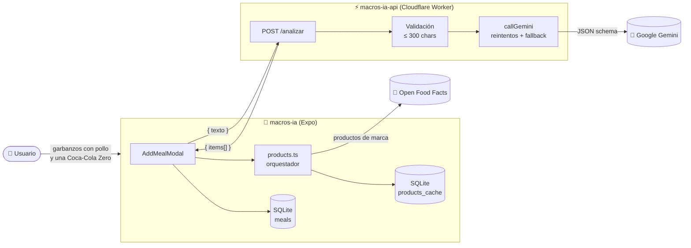
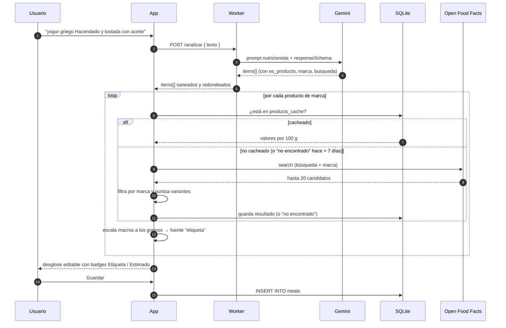
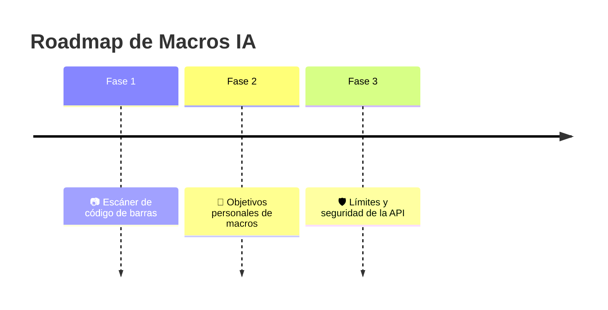

<div align="center">

# 🥗 Macros IA

### Cuenta calorías y macros escribiendo lo que has comido. Así de simple.

*"plato de garbanzos con pollo y una caña"* → **kcal · proteína · carbos · grasa**, al momento.

<br/>


<br/>


<br/>

[✨ Funcionalidades](#-funcionalidades) ·
[🏗️ Arquitectura](#️-arquitectura) ·
[🚀 Puesta en marcha](#-puesta-en-marcha) ·
[📡 API](#-api) ·
[🗺️ Próximos pasos](#️-próximos-pasos)

</div>

---

## 💡 ¿Qué es esto?

**Macros IA** es una app móvil para llevar el registro diario de lo que comes **sin pesar nada y sin buscar en bases de datos interminables**. Escribes en lenguaje natural, como se lo contarías a un amigo, y una IA nutricionista entrenada para la **cocina española** lo separa en ingredientes, estima raciones y calcula los macros.

¿Y si dices una marca? *"Una Coca-Cola Zero y un yogur griego Hacendado"* → la app detecta que son **productos envasados** y va a buscar los **valores reales de la etiqueta** en [Open Food Facts](https://es.openfoodfacts.org). Lo mejor de los dos mundos: estimación inteligente para lo casero, datos exactos para lo envasado.

El proyecto es un **monorepo** con dos piezas:

| Proyecto | Qué es | Stack |
|---|---|---|
| 📱 [`macros-ia/`](./macros-ia) | La app móvil (iOS · Android · Web) | Expo 58 · React Native 0.88 · React 19 · `expo-sqlite` |
| ⚡ [`macros-ia-api/`](./macros-ia-api) | Backend serverless que habla con la IA | Cloudflare Workers · Gemini · Wrangler · Vitest |

---

## ✨ Funcionalidades

<table>
<tr>
<td width="50%" valign="top">

### 🧠 Análisis con IA
- Describe la comida en **lenguaje natural**, sin pesos.
- Desglose automático en **ingredientes principales**.
- Raciones estándar de un adulto en España si no indicas cantidad.
- Respeta cantidades explícitas: *"2 huevos"*, *"media pizza"*, *"200 g"*.
- Incluye el **aceite** de cocinar/aliñar cuando el plato lo lleva (el gran olvidado 👀).

</td>
<td width="50%" valign="top">

### 🏷️ Productos de marca → datos reales
- Detecta marcas y supermercados (Hacendado, Lidl, Danone, Coca-Cola…).
- *"Mercadona"* se traduce a **Hacendado** automáticamente.
- Busca en **Open Food Facts** con un sistema de puntuación propio.
- Distingue variantes: **zero, light, sin azúcar, desnatado…**
- Cada ingrediente muestra su origen: `Etiqueta` ✅ o `Estimado` 🤖.

</td>
</tr>
<tr>
<td width="50%" valign="top">

### ✏️ Control total
- Ajusta los **gramos** de cada ingrediente y los macros se recalculan al vuelo.
- Elimina ingredientes que la IA haya añadido de más.
- Modo **manual** para meter valores a mano cuando quieras.
- Mantén pulsado una comida para **borrarla**.

</td>
<td width="50%" valign="top">

### 📅 Diario offline-first
- Navega por días: **Hoy, Ayer, Mañana** y cualquier fecha.
- Totales del día: **kcal, proteína, carbos y grasa**.
- Todo se guarda **en el dispositivo** con SQLite (WAL).
- Caché local de productos: menos peticiones, más velocidad.

</td>
</tr>
</table>

---

## 🏗️ Arquitectura



### 🔄 El viaje de una comida



### 🧩 Detalles que marcan la diferencia

<details>
<summary><b>⚡ Backend resiliente con fallback de modelos</b></summary>

<br/>

El Worker no confía en un único modelo. Prueba en cascada:

```ts
const MODELS = ['gemini-3.5-flash-lite', 'gemini-3.1-flash-lite'];
```

Cada modelo se intenta **2 veces** con backoff (500 ms, 1000 ms) ante errores `500/503/504`. Si todo falla, devuelve un error legible (`saturado`, `cuota`, `ia`) que la app traduce a mensajes amigables en español.

La respuesta de Gemini se fuerza con `responseMimeType: application/json` + `responseSchema`, y luego se **sanea**: números negativos o no finitos → 0, redondeos, y `marca`/`busqueda` vacíos si no es producto.

</details>

<details>
<summary><b>🎯 Matching inteligente con Open Food Facts</b></summary>

<br/>

Buscar *"coca cola"* en una base de datos colaborativa devuelve de todo. El orquestador (`products.ts` + `openfoodfacts.ts`):

1. **Normaliza** texto (minúsculas, sin tildes, sin símbolos).
2. **Filtra por marca** (coincidencia parcial o por primera palabra).
3. **Descarta** productos sin kcal/proteína/carbos/grasa (convierte kJ → kcal si hace falta).
4. **Puntúa**: +1 por cada palabra de la búsqueda presente en el nombre, **−3** por cada variante (`zero`, `light`, `sin azucar`, `desnatad`…) que no coincida entre lo pedido y lo encontrado. Así una Coca-Cola normal nunca se confunde con una Zero.
5. Se queda con el **mejor candidato** y escala los valores por 100 g a los gramos reales.

</details>

<details>
<summary><b>💾 Base de datos local con migraciones versionadas</b></summary>

<br/>

SQLite con `PRAGMA user_version` para migrar sin perder datos:

| Versión | Cambio |
|:-:|---|
| `1` | Tabla `meals` + índice por fecha, modo WAL |
| `2` | Tabla `settings` (clave/valor) |
| `3` | Tabla `products_cache` |
| `4` | Limpieza de caché tras mejorar el matching |

La caché guarda también los **"no encontrados"**, que se reintentan pasados **7 días** para no martillear a Open Food Facts.

</details>

---

## 📂 Estructura

```
macros_ia_project/
├── 📱 macros-ia/                  # App Expo
│   ├── App.tsx                    # SQLiteProvider + migraciones
│   └── src/
│       ├── api.ts                 # Cliente del Worker (timeout 20 s, errores amigables)
│       ├── config.ts              # URL de la API
│       ├── db.ts                  # Esquema, migraciones y queries
│       ├── openfoodfacts.ts       # Búsqueda y scoring en OFF
│       ├── products.ts            # Orquestador: caché + OFF + escalado
│       ├── theme.ts               # Paleta de colores
│       ├── utils/date.ts          # Claves de fecha y etiquetas en español
│       ├── components/
│       │   ├── AddMealModal.tsx   # Modo IA / Manual, edición de gramos
│       │   ├── MealItem.tsx
│       │   └── TotalsCard.tsx
│       └── screens/
│           └── DayScreen.tsx      # Pantalla principal del día
│
└── ⚡ macros-ia-api/              # Cloudflare Worker
    ├── src/index.ts               # POST /analizar → Gemini
    ├── wrangler.jsonc
    ├── .dev.vars.example          # GEMINI_API_KEY
    └── test/
```

---

## 🚀 Puesta en marcha

### Requisitos

- **Node.js** 20+
- Una **API key de Google Gemini** → [Google AI Studio](https://aistudio.google.com/apikey)
- Una cuenta de **Cloudflare** (solo para desplegar)
- **Expo Go** en el móvil o un emulador Android/iOS

### 1️⃣ Backend (`macros-ia-api`)

```bash
cd macros-ia-api
npm install

# Configura tu clave para desarrollo local
cp .dev.vars.example .dev.vars
# edita .dev.vars → GEMINI_API_KEY=tu-clave

npm run dev        # → http://localhost:8787
```

Pruébalo:

```bash
curl -X POST http://localhost:8787/analizar \
  -H "Content-Type: application/json" \
  -d '{"texto": "tortilla de patatas y una caña"}'
```

Desplegar a producción:

```bash
npx wrangler secret put GEMINI_API_KEY
npm run deploy
```

### 2️⃣ App (`macros-ia`)

```bash
cd macros-ia
npm install
```

Apunta la app a tu Worker en [`src/config.ts`](./macros-ia/src/config.ts):

```ts
export const API_URL = "https://macros-ia-api.<tu-subdominio>.workers.dev";
// o en local, con la IP de tu ordenador: "http://192.168.x.x:8787"
```

Y arranca:

```bash
npm start          # escanea el QR con Expo Go
npm run android    # emulador Android
npm run ios        # simulador iOS
npm run web        # navegador
```

---

## 📡 API

### `POST /analizar`

**Request**

```json
{ "texto": "yogur griego Hacendado y dos tostadas con aceite" }
```

**Response `200`**

```json
{
  "items": [
    {
      "nombre": "Yogur griego",
      "gramos": 125,
      "kcal": 150,
      "proteina": 4.5,
      "carbos": 5.1,
      "grasa": 12.5,
      "es_producto": true,
      "marca": "Hacendado",
      "busqueda": "yogur griego"
    },
    {
      "nombre": "Pan tostado",
      "gramos": 60,
      "kcal": 160,
      "proteina": 5.4,
      "carbos": 30,
      "grasa": 1.2,
      "es_producto": false,
      "marca": "",
      "busqueda": ""
    }
  ]
}
```

> Los valores son ilustrativos: dependen de lo que estime el modelo.

**Errores**

| Código | `error` | Significado |
|:-:|---|---|
| `400` | `json_invalido` | El body no es JSON válido |
| `400` | `texto_vacio` | No se ha enviado texto |
| `400` | `texto_largo` | Más de 300 caracteres |
| `404` | `no_encontrado` | Ruta inexistente |
| `405` | `metodo_no_permitido` | Solo se acepta `POST` |
| `429` | `cuota` | Cuota de Gemini agotada |
| `500` | `falta_api_key` / `interno` | Error de configuración o inesperado |
| `502` | `ia` | Respuesta de la IA inválida |
| `503` | `saturado` | Gemini saturado tras todos los reintentos |

---

## 🗺️ Próximos pasos



### 📷 1. Escáner de código de barras

Escanear el envase y tener los macros **exactos** sin escribir nada.

- [ ] Lector de códigos EAN-13 / EAN-8 / UPC con la cámara (`expo-camera`).
- [ ] Consulta directa a Open Food Facts por código (`/api/v2/product/{barcode}`), mucho más fiable que la búsqueda por texto.
- [ ] Reutilizar `products_cache` usando el código de barras como clave.
- [ ] Pantalla de confirmación con los gramos editables (ración del envase por defecto).
- [ ] Fallback a la IA o al modo manual si el producto no existe en OFF.

### 🎯 2. Objetivos personales de macros

Que la app no solo cuente, sino que **guíe**.

- [ ] Pantalla de perfil: objetivo diario de kcal, proteína, carbos y grasa (guardado en `settings`).
- [ ] Calculadora opcional (edad, peso, altura, actividad, objetivo: perder / mantener / ganar).
- [ ] Barras o anillos de progreso en `TotalsCard` con lo que queda por comer.
- [ ] Indicadores visuales al pasarse de un objetivo.
- [ ] Vista semanal con medias y cumplimiento.

### 🛡️ 3. Límites y seguridad de la API

Ahora mismo `/analizar` es un endpoint público: cualquiera con la URL podría consumir la cuota de Gemini. Objetivo: **limitar peticiones y aceptar solo las que vengan de la app**.

- [ ] **Rate limiting** por dispositivo/IP con el binding de [Rate Limiting de Workers](https://developers.cloudflare.com/workers/runtime-apis/bindings/rate-limit/) o un contador en KV / Durable Objects (p. ej. N análisis por minuto y por día).
- [ ] **Identificador de instalación** generado en la app y enviado en cada petición, para aplicar cuotas por usuario.
- [ ] **Verificación de que la petición viene de la app**: atestación de dispositivo con [Play Integrity](https://developer.android.com/google/play/integrity) (Android) y [App Attest](https://developer.apple.com/documentation/devicecheck) (iOS), validada en el Worker.
- [ ] Peticiones **firmadas** (HMAC con timestamp) para evitar replays. *Ojo: un secreto embebido en la app se puede extraer, así que esto complementa a la atestación, no la sustituye.*
- [ ] Rechazar cuerpos demasiado grandes antes de parsearlos y dejar de devolver `detalle` del error interno al cliente.
- [ ] Reglas de **WAF / Bot Fight Mode** de Cloudflare como primera barrera.

---

## ⚠️ Aviso

Las calorías y macros que calcula la IA son **estimaciones aproximadas**. Úsalas como orientación, no como valores exactos ni como consejo médico o nutricional. Los datos de productos provienen de **Open Food Facts**, una base de datos colaborativa que puede contener errores.

---

## 🙌 Créditos

- [Open Food Facts](https://world.openfoodfacts.org) — base de datos abierta de productos alimentarios (ODbL).
- [Google Gemini](https://ai.google.dev) — el nutricionista que vive en la nube.
- [Expo](https://expo.dev) y [Cloudflare Workers](https://workers.cloudflare.com) — por hacer que esto sea gratis de montar.

<div align="center">

<br/>

Hecho con 🫒 y mucho aceite de oliva por [**@JoseMasiaTormo**](https://github.com/JoseMasiaTormo)

</div>
